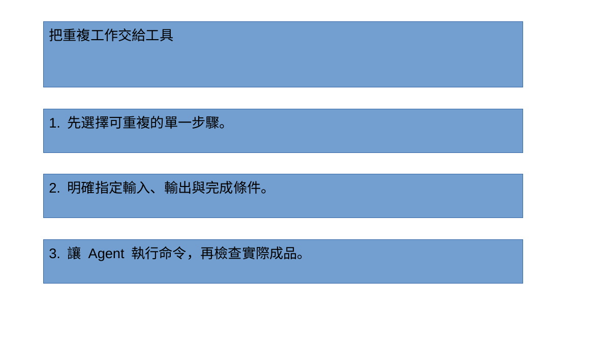

# 第 7 章：製作教材與簡報素材

將同一份課程 JSON 轉成文字簡報、講義與獨立圖片素材包。延續既有安裝環境，無需新增 Python 套件。

從儲存庫根目錄執行：

```bash
python ch07/build_lesson.py --input ch07/lesson.json --output output/ch07 --dry-run
python ch07/build_lesson.py --input ch07/lesson.json --output output/ch07
```

預期結束碼 `0`、簡報 4 頁；程式檢查 PPTX 內每張投影片文字、PDF 頁數與逐頁文字，並產生所有 PDF 頁面的預覽圖。

範例已在本書 Ubuntu 環境產生 4 頁簡報與 1 頁講義，並查看四張投影片預覽。可直接下載 [參考簡報](../reference/lesson-slides.pptx) 與 [PDF 講義](../reference/lesson-handout.pdf)。



| 產物 | 用途 |
| --- | --- |
| `slides.json`、`handout.json` | CLI 專案；不要與課程來源 `lesson.json` 混淆 |
| `slides.odp`、`slides.pptx` | 可編輯的文字簡報初稿 |
| `slides.pdf` | 由簡報專案匯出的 PDF |
| `handout.odt`、`handout.pdf` | 含課堂活動說明的講義 |
| `assets/` | 第 6 章三張參考圖片的副本，尚未嵌入簡報 |
| `previews/` | 簡報與講義各頁 PNG |
| `verification.json` | 基本檢查結果與執行命令 |

課程 JSON 使用 `title` 及 `slides`；每張投影片包含 `title`、`points`、`notes`。`notes` 用於講義中的課堂活動文字，**不是 PowerPoint 備忘稿欄位**。

教學用限制：1～12 張投影片，每張 1～3 個重點，標題最多 24 字、每點最多 36 字。這些是本範例設定的限制，不是 CLI-Anything 官方規格，也不保證字型或版面一定合適。

## 實際驗證的範圍

- 文字框與基本內容輸出；沒有套用美術模板、字級調整、動畫或圖片嵌入。
- 本書固定 commit 的 `add-element` 接受 `image`，但 ODF 簡報輸出程式只處理額外的 `text_box`，因此範例將圖片另存為素材。
- PDF 由 CLI 簡報專案另行匯出，並非重新開啟 PPTX 後轉檔。PPTX 在 Microsoft PowerPoint 中的顯示相容性尚未驗證。
- 固定版本的 ODF 輸出沒有套用 Impress 頁面 profile；本例採 LibreOffice 匯入時的預設頁面，實測 PDF 為 28 × 15.75 公分。不要僅憑專案設定值判定成品尺寸。
- 自動檢查能確認文字存在，無法判斷閱讀距離、裁切、字級或排版品質。請開啟每頁預覽，再以 Impress 調整初稿。

## 練習

1. 複製 `lesson.json`，改成自己要教的主題，輸出到新目錄。
2. 新增第 5 張投影片，確認 PPTX 與 PDF 同為 5 頁。
3. 刻意刪除一張投影片的 `notes`，確認 dry-run 在建立輸出前指出格式錯誤。
4. 用 Impress 將 `assets/square.png` 插入副本，另存並重新檢查；手工修改後的版本不在原驗證報告涵蓋範圍內。
